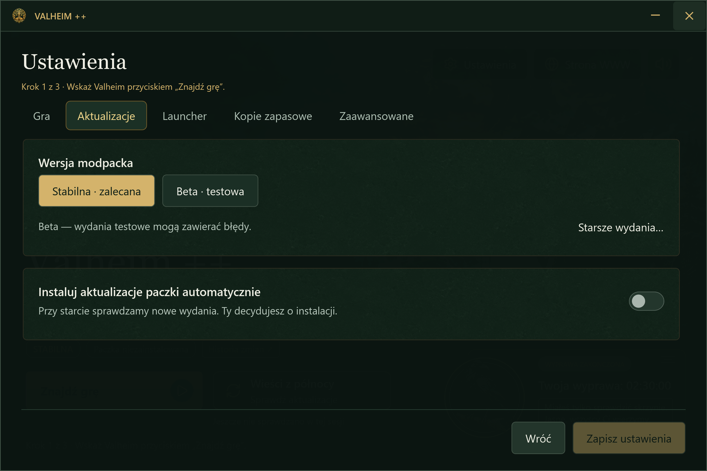

# Launcher Valheim ++

Jedno miejsce do instalacji paczki, aktualizacji i uruchamiania gry. Nie musisz ręcznie przenosić modów ani śledzić, które pliki zmieniły się między wydaniami.

## Pierwsza instalacja

Launcher działa jako samodzielny plik **ValheimPlusPlus.exe**. Wskaż zainstalowane Valheim — automatycznie lub przez wybór `valheim.exe` — i zainstaluj paczkę. Postęp pobierania pokazuje ilość danych, prędkość i przybliżony czas do końca, gdy dostępne są dane potrzebne do oszacowania.

[Pierwszy start krok po kroku →](01-instalacja.html)

## Aktualizacje i opisy zmian

**Wieści z północy** sprawdzają wydania paczki i launchera. Przy automatycznym sprawdzaniu ten przycisk pojawia się dopiero po zakończeniu operacji. Przed aktualizacją przeczytasz opis najnowszego wydania i historię pominiętych wersji. Paczkę i launcher aktualizujesz osobno.

Przy uruchomieniu launcher sprawdza nowe wydania. W ustawieniach możesz dodatkowo włączyć automatyczne instalowanie paczki. Samo sprawdzanie nie oznacza zgody na instalację.

[Jak sprawdzić i zainstalować aktualizację →](02-pierwsze-kroki.html)

## Stabilna paczka, beta i wcześniejsze wydania

Wybierz kanał stabilny do zwykłej gry albo betę do testów. Lista wcześniejszych wydań pozwala przeczytać zmiany i zainstalować potrzebną wersję, np. zgodną z serwerem. Starsze wydanie zostaje przypięte, aby kolejna aktualizacja nie zastąpiła go bez Twojej decyzji.

[Wybór wersji, przypięcie i powrót do najnowszej →](03-mody.html)

## Sprawdzanie i naprawa paczki

Naprawa wyszukuje brakujące pliki zainstalowanej wersji. Wynik pokazuje podsumowanie braków; pełną listę możesz otworzyć i przeszukać. Uzupełnianie nie nadpisuje istniejących konfiguracji, nie usuwa dodatkowych plików i pomija chronione dane gracza. Światy i postacie pozostają nietknięte.

To nie jest kontrola zawartości każdego pliku: plik zmieniony lub uszkodzony, ale nadal obecny, nie zostanie uznany za brakujący.

[Kiedy użyć naprawy i co zrobić, jeśli nie pomaga →](05-pomoc.html#brakuje-plikow-lub-zmieniales-paczke-recznie)

## Kopie i cofanie aktualizacji

Przy zmianie paczki launcher zachowuje poprzednią wersję. Możesz do niej wrócić z ustawień kopii zapasowych. Chronione pliki danych gracza mają osobną historię do 10 ostatnich kopii, oddzielnie dla kanału stabilnego i bety. Starsze pełne kopie, jeśli je posiadasz, również można przywrócić.

**Kopia paczki nie jest kopią świata ani postaci.** Zapisy gry zabezpiecz osobno. Ochrona plików modów obejmuje reguły paczki, nie dowolne własne pliki.

[Co obejmują kopie i jak odzyskać dane →](04-wspolna-gra.html)

## Gra, muzyka i podsumowanie wyprawy

Kliknij **Graj**, a muzyka łagodnie wyciszy się do zera. Launcher czeka na właściwe okno Valheim, następnie chowa się do zasobnika i zaczyna liczyć czas sesji. Po zakończeniu gry wraca na ekran, a muzyka płynnie odzyskuje głośność — chyba że została przez Ciebie wyciszona.

Kruk podsumowuje czas wyprawy i łączny czas gry. Przynosi też wieści o aktualizacjach. Jego dźwięk możesz wyłączyć niezależnie od muzyki. Launcher zapamiętuje położenie swojego okna.

## Ustawienia i pomoc przy błędach

Ustawienia grupują lokalizację gry, aktualizacje, zachowanie launchera, kopie i opcje zaawansowane. Niezapisane zmiany wymagają decyzji przed wyjściem. Podczas trwającej operacji niedostępne działania pozostają zablokowane.

Komunikat błędu wyjaśnia problem i następny krok. **Kopiuj raport** przygotowuje informacje do zgłoszenia; szczegóły techniczne są zwijane. **Otwórz log** pozwala obejrzeć lokalny zapis zdarzeń. Raport nie wysyła się sam. Przed udostępnieniem logu sprawdź, czy nie ma w nim prywatnych danych.

[Rozwiązywanie problemów i przygotowanie zgłoszenia →](05-pomoc.html)
