# Launcher Valheim ++

Jedno miejsce do instalacji paczki, aktualizacji, modów i uruchamiania gry. Nie musisz ręcznie przenosić plików ani śledzić, co zmieniło się między wydaniami. Poniżej najważniejsze możliwości wersji 1.0.1.

## Profile: kilka wypraw w jednym launcherze

Każdy profil ma własną nazwę, avatar i **własną instalację paczki**, więc jeden możesz mieć do codziennej gry, drugi do testów, a trzeci na ekstremalne zestawy modów. Profil wybierasz kliknięciem w kafel; aktywny ma złotą ramkę, a kafel pokazuje wersję zainstalowanej paczki. Do wyboru jest sześć avatarów albo własny obraz.

**Beta to osobny profil**: zaznacz „Profil beta” przy zakładaniu, a dostaje wersje testowe i złotą odznakę na avatarze. Profil stabilny dostaje wyłącznie wydania stabilne. Światy i postacie są wspólne dla wszystkich profili — różnią się paczka i mody.

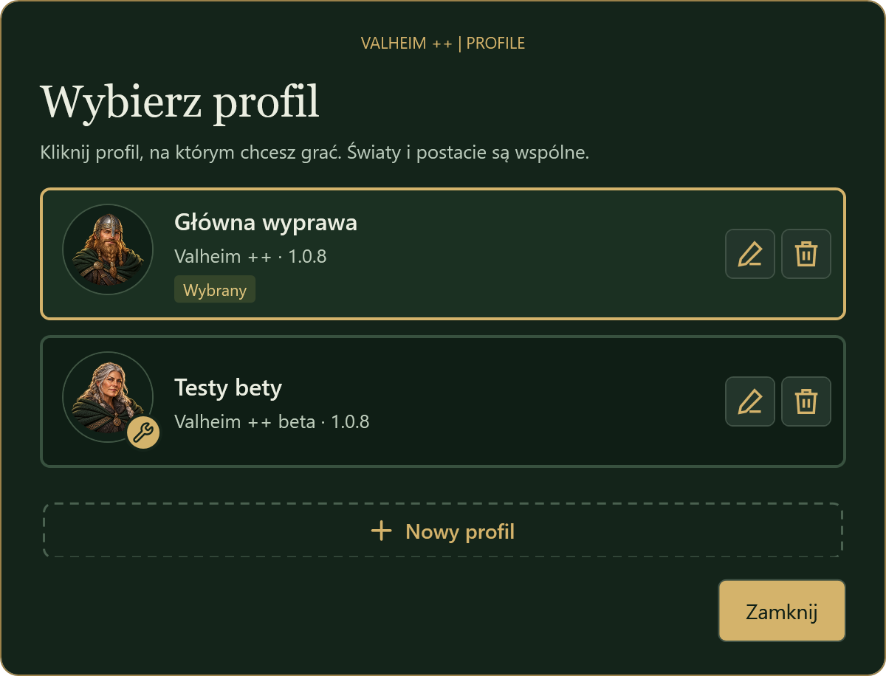

[Jak założyć profil i grać na kilku →](07-profile-i-mody.html)

## Mody pod ręką

Zakładka **Mody** pokazuje listę z wyszukiwarką i filtrami oraz przełącznikiem włącz/wyłącz przy każdym modzie. Zmiana dotyka tylko plików danego moda. Własne mody (plik DLL lub ZIP) dodasz przyciskiem **Dodaj mod**, a usunięte trafiają do archiwum, z którego możesz je przywrócić.

Aktualizacja paczki nie kasuje Twoich własnych dodatków, a naprawa omija mody wyłączone celowo. Dodawaj wyłącznie pliki z zaufanego źródła — mody wykonują kod na Twoim komputerze.

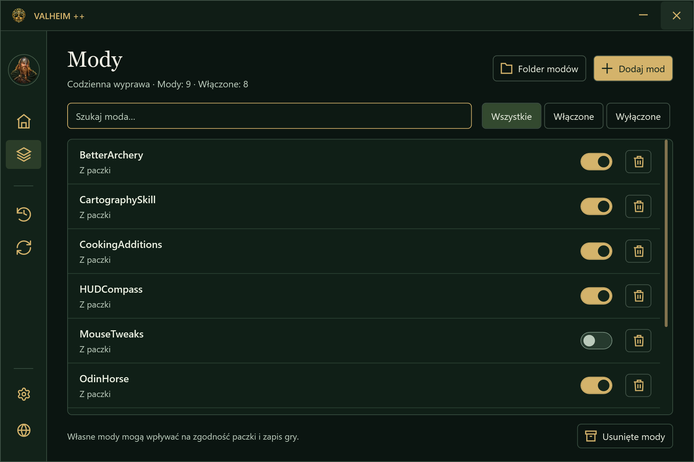

[Jak zarządzać modami →](07-profile-i-mody.html#mody-wlaczanie-wylaczanie-i-wlasne-pliki)

## Pierwsza instalacja

Launcher działa jako samodzielny plik **ValheimPlusPlus.exe**. Wskaż zainstalowane Valheim — automatycznie lub przez wybór `valheim.exe` — i zainstaluj paczkę. Na świeżym profilu przycisk **Zainstaluj paczkę** jest od razu aktywny. Okno pobierania pokazuje procent, etap instalacji oraz ile już pobrano, z jaką prędkością i ile zostało.

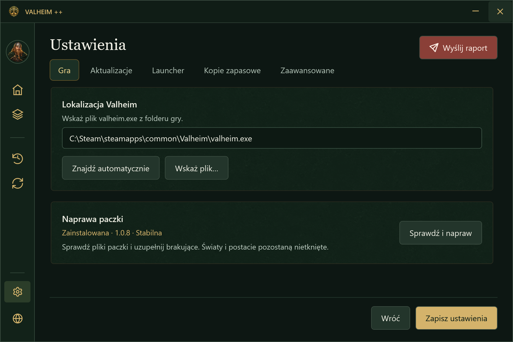

[Pierwszy start krok po kroku →](01-instalacja.html)

## Aktualizacje i Wieści z północy

Launcher sprawdza wydania przy starcie i co 10 minut. Możesz też zrobić to ręcznie przyciskiem **Wieści z północy**; wynik widać od razu. Gdy jest coś nowego, wybierasz **Aktualizuj i graj** albo **Graj bez aktualizacji** i widzisz, co się zmieniło, także w pominiętych wydaniach. Samo sprawdzanie nie oznacza zgody na instalację, a aktualizację samego launchera zawsze zatwierdzasz Ty.

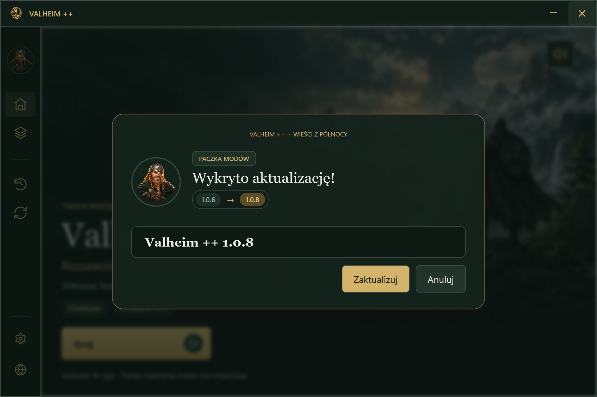

[Jak sprawdzić i zainstalować aktualizację →](02-pierwsze-kroki.html)

## Historia zmian

W menu bocznym jest **Historia zmian**: najnowsze wydania paczki, bety i samego launchera z krótkimi opisami i filtrami. Pełne opisy i starsze wydania znajdziesz na stronie w [historii zmian](changelog.html#launcher).

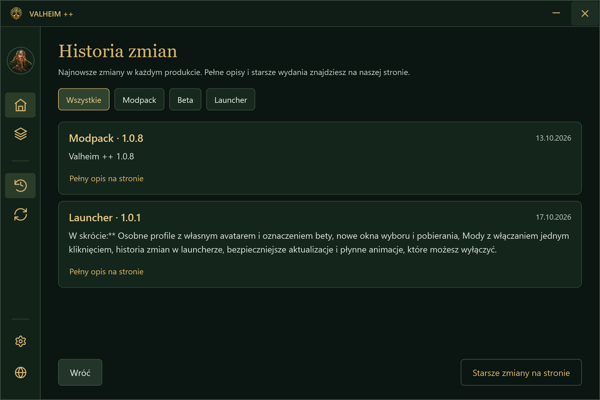

[Pełna historia zmian →](changelog.html#launcher)

## Starsze wydania i przypięcie wersji

Lista wcześniejszych wydań pozwala przeczytać zmiany i zainstalować potrzebną wersję, np. zgodną z serwerem. Starsze wydanie zostaje przypięte, aby kolejna aktualizacja nie zastąpiła go bez Twojej decyzji. Powrót do najnowszej wersji potwierdzasz po kliknięciu kruka.

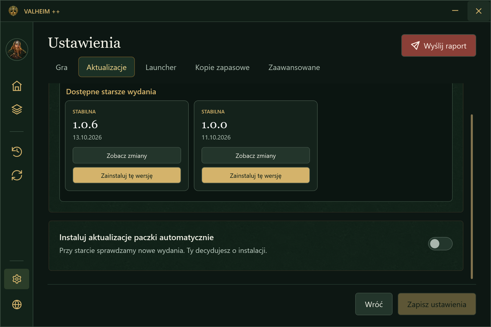

[Wybór wersji, przypięcie i powrót do najnowszej →](03-mody.html)

## Sprawdzanie i naprawa paczki

Naprawa wyszukuje brakujące pliki zainstalowanej wersji. Wynik pokazuje podsumowanie braków; pełną listę możesz otworzyć i przeszukać. Uzupełnianie nie nadpisuje istniejących konfiguracji, nie usuwa dodatkowych plików i pomija chronione dane gracza oraz mody wyłączone celowo. Światy i postacie pozostają nietknięte.

To nie jest kontrola zawartości każdego pliku: plik zmieniony lub uszkodzony, ale nadal obecny, nie zostanie uznany za brakujący.

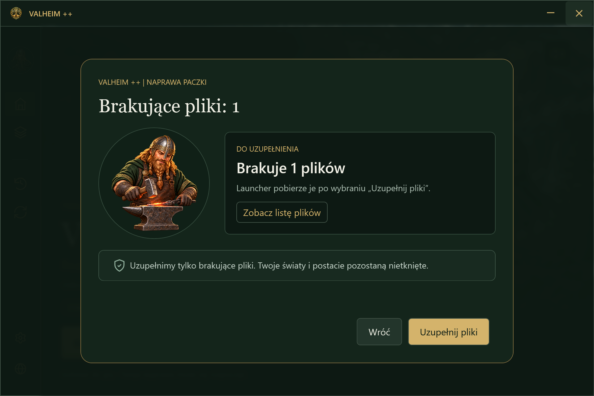

[Kiedy użyć naprawy i co zrobić, jeśli nie pomaga →](05-pomoc.html#brakuje-plikow-lub-zmieniales-paczke-recznie)

## Kopie i cofanie aktualizacji

Przy zmianie paczki launcher zachowuje poprzednią wersję. Możesz do niej wrócić z ustawień kopii zapasowych. Chronione pliki danych gracza mają osobną historię do 10 ostatnich kopii. Starsze pełne kopie, jeśli je posiadasz, również można przywrócić.

**Kopia paczki nie jest kopią świata ani postaci.** Zapisy gry zabezpiecz osobno. Ochrona plików modów obejmuje reguły paczki, nie dowolne własne pliki.

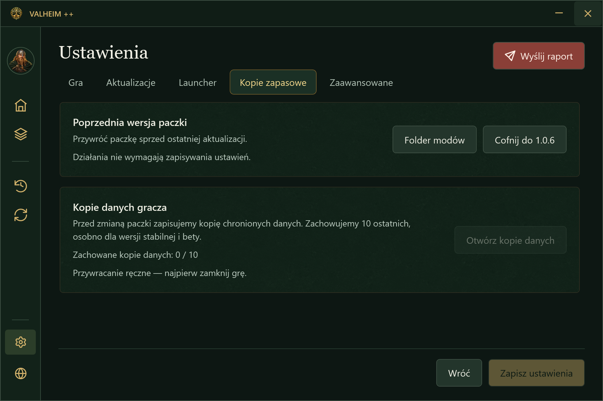

[Co obejmują kopie i jak odzyskać dane →](04-wspolna-gra.html)

## Gra, muzyka i podsumowanie wyprawy

Kliknij **Graj**, a muzyka łagodnie wyciszy się do zera. Launcher czeka na właściwe okno Valheim, następnie chowa się do zasobnika i zaczyna liczyć czas sesji. Po zakończeniu gry wraca na ekran, a muzyka płynnie odzyskuje głośność — chyba że została przez Ciebie wyciszona. Jeśli gra się zawiesi, pomoże przycisk **Wymuś zamknięcie gry** z ostrzeżeniem.

Kruk podsumowuje czas wyprawy i łączny czas gry. Przynosi też wieści o aktualizacjach. Jego dźwięk możesz wyłączyć niezależnie od muzyki. Launcher zapamiętuje położenie swojego okna.

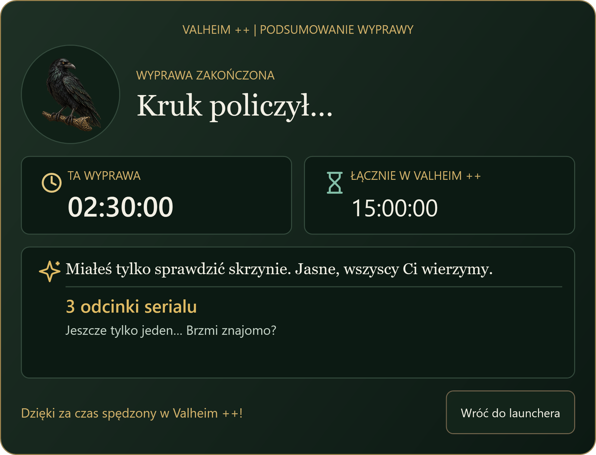

## Wyślij raport

Coś nie działa? W ustawieniach kliknij czerwony przycisk **Wyślij raport**. Opisz problem własnymi słowami (do 200 znaków), opcjonalnie podaj nick i zaznacz **Dołącz szczegóły profilu i modów** — to zalecane, bo ułatwia znalezienie przyczyny. Log gry dołącza się automatycznie, a przed wysłaniem możesz podejrzeć załączniki. Dane prywatne, np. ścieżki z nazwą użytkownika, są maskowane, nie potrzebujesz żadnego kodu dostępu, a raport wysyła się dopiero po Twoim kliknięciu.

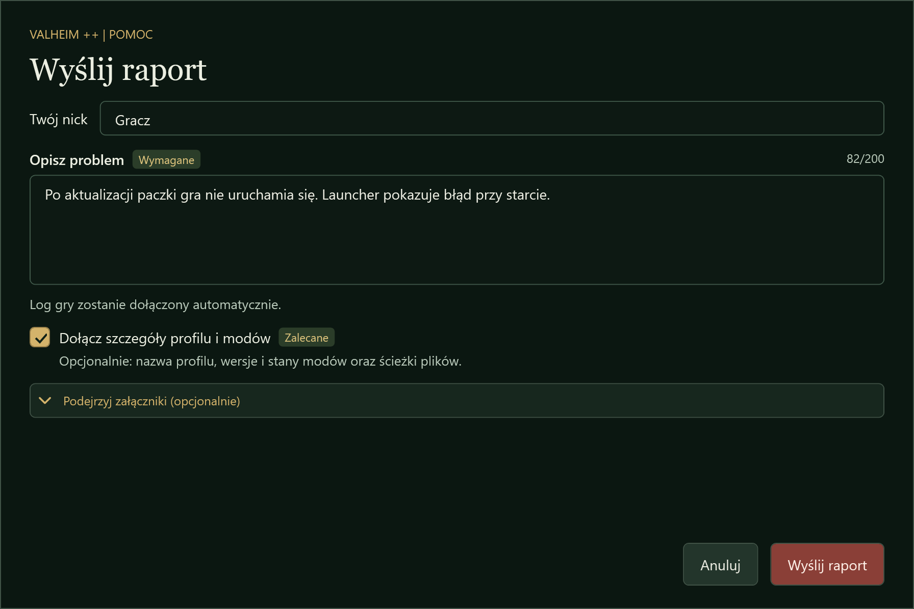

[Jak wysłać raport krok po kroku →](07-profile-i-mody.html#wyslij-raport)

## Ustawienia, animacje i pomoc przy błędach

Ustawienia grupują lokalizację gry, aktualizacje, zachowanie launchera, kopie i opcje zaawansowane. W **Ustawienia → Launcher → Animacje interfejsu** wyłączysz cały ruch, jeśli wolisz natychmiastowy interfejs albo masz słabszy komputer. Niezapisane zmiany wymagają decyzji przed wyjściem.

Komunikat błędu wyjaśnia problem i następny krok. **Kopiuj raport** przygotowuje informacje do zgłoszenia. **Otwórz log** pozwala obejrzeć lokalny zapis zdarzeń. Przed udostępnieniem logu sprawdź, czy nie ma w nim prywatnych danych.

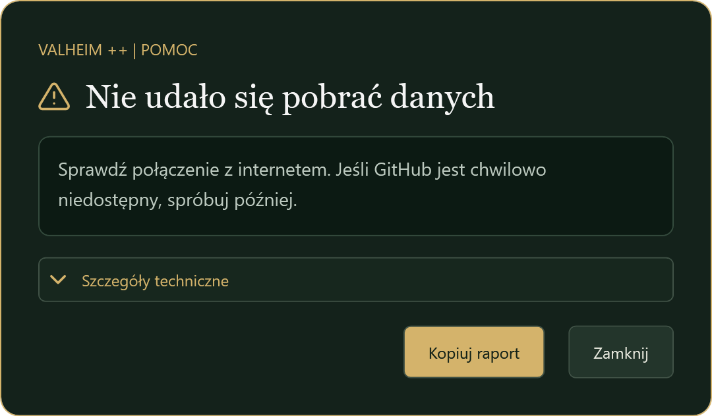

[Rozwiązywanie problemów i przygotowanie zgłoszenia →](05-pomoc.html)
